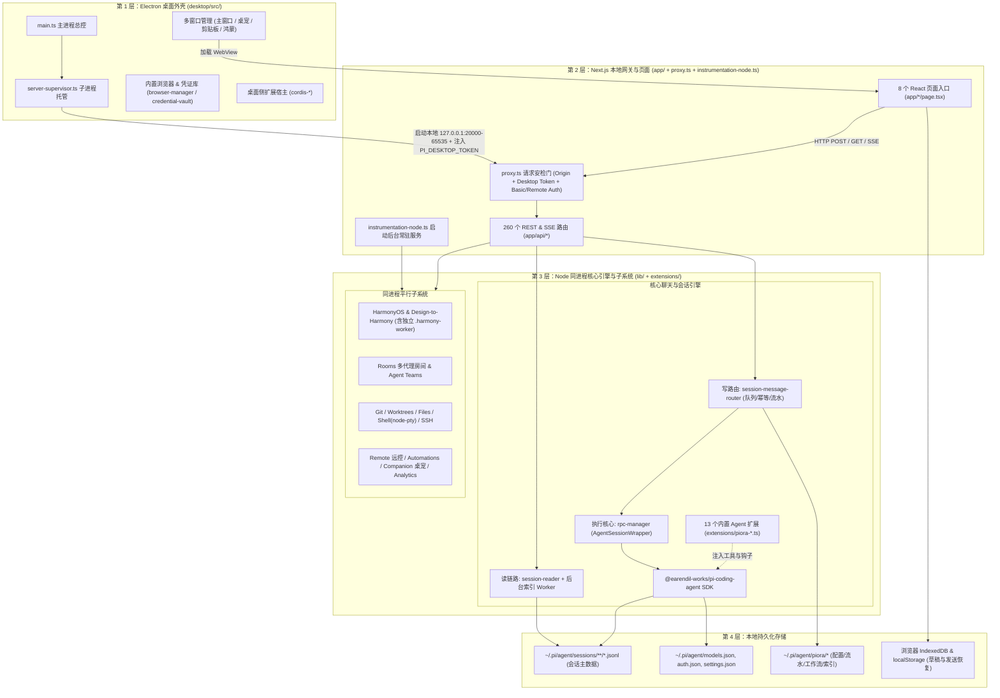
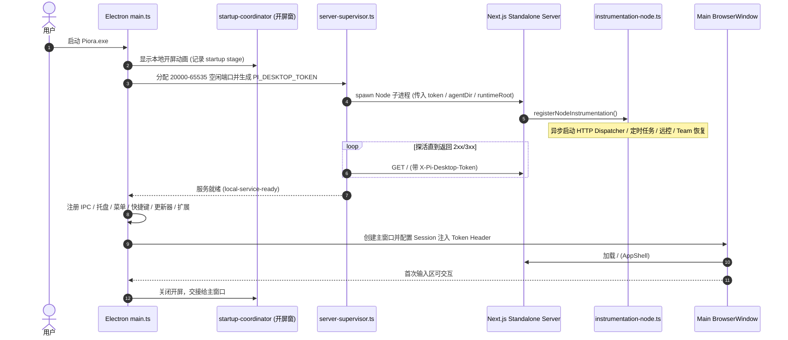
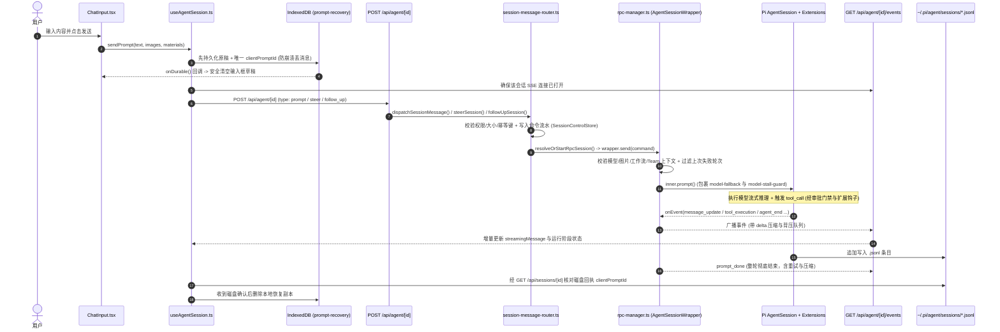

# Piora 架构导览手册

> 适用对象：希望快速建立全局心智模型、重新掌控代码库结构与演进方向的项目负责人与开发者。<br>
> 基线盘点日期：2026-11-20（版本 `0.5.11-beta.22`）

---

## 1. 一句话定位与工程体量

**Piora = Pi Coding Agent 内核（本地执行） + Next.js 本地工作台（前后端一体） + Electron 桌面外壳（原生能力）**。

在 2026-08 早期基线时，项目仅有约 44 个 API、30 个前端组件和 ~70 个 `lib/` 文件；经过高速迭代，截至当前已经演进为一个中大型桌面工程：

| 维度 | 当前规模 | 说明 |
| --- | --- | --- |
| 业务源码 | **1,525 个文件 / ~21.5 万行** | `lib/` 8.86 万行、`components/` 5.86 万行、`scripts/` 2.02 万行、`desktop/` 1.91 万行、`app/` 1.48 万行 |
| 自动化测试 | **807 个文件 / ~9.9 万行** | 主要与源码同目录存放（`*.test.mjs`） |
| Next.js API 路由 | **260 个路由处理器 / 53 个业务前缀** | 鸿蒙相关（`harmony` + `design-to-harmony`）占 65 个，约 1/4 |
| 前端页面入口 | **8 个页面** | 主工作台 `app/page.tsx` + 7 个桌宠/悬浮窗/剪贴板/鸿蒙独立窗口页 |
| Agent 内置扩展 | **13 个** | `extensions/piora-*.ts`，向 Pi Agent 注入工具与钩子 |
| 服务端内存全局单例 | **~98 个 `globalThis` 键** | 用于在 Next.js 热更新（HMR）期间保持内存状态不丢失 |

理解这个工程的关键不是“逐文件通读”，而是**先抓 4 层骨架，再打通 1 条黄金主链路，最后把 53 个模块分成三圈管理**。

---

## 2. 四层总体架构



### 各层一句话职责

1. **Electron 桌面外壳（`desktop/src/`）**：负责操作系统级能力。它不直接运行大模型，而是通过 `server-supervisor.ts` 启动并看护 Next.js 独立 Node 服务，再用一个随机一次性令牌 `PI_DESKTOP_TOKEN` 绑定两者之间的通信。
2. **Next.js 网关与多页面（`app/`、`proxy.ts`、`instrumentation-node.ts`）**：既是前端界面服务器，也是本地 API 后端。`proxy.ts` 守在所有 `/` 与 `/api/*` 请求之前做安全鉴权；`instrumentation-node.ts` 在服务启动时异步拉起后台常驻能力（HTTP 代理分发、组织统计补账、局域网发现、定时自动化、远控连接器、Agent Team 恢复）。
3. **同进程核心引擎与子系统（`lib/`、`extensions/`）**：**读/写严格分离**。浏览历史会话时只读 `.jsonl` 文件，不创建 Agent 实例；只有发送消息、执行命令或订阅实时事件时，才通过 `rpc-manager.ts` 在当前 Node 进程内创建 `AgentSessionWrapper`。
4. **本地持久化（`~/.pi/agent/` + 浏览器存储）**：Piora 是本地优先架构，没有中心云端数据库。会话正文以 Pi 原生 `.jsonl` 树形日志落盘，所有 Piora 附加偏好与队列状态保存在 `~/.pi/agent/piora/`。

---

## 3. 应用启动时序图

理解桌面端开机时“谁先启动、谁等谁”：



---

## 4. 黄金主链路：用户发送一条消息的全流程

**如果你只想先看懂整个项目最核心的 10% 代码，请死磕这一张图。**



### 主链路必须记住的 5 条核心设计约束

1. **读与写彻底分离**：打开侧栏浏览任意会话走 `GET /api/sessions` → `lib/session-reader.ts`（含后台索引 Worker 与分页预算，首包仅返回最近 40 轮），**不会**启动 `AgentSession`；只有发消息、跑命令或切模型才按需拉起 `rpc-manager.ts`。
2. **双保险防丢消息**：发送前先落浏览器 IndexedDB，并携带唯一 `clientPromptId`；**绝对不靠 SSE 或内存态确认送达**，只有从磁盘 `.jsonl` 或命令流水读到该幂等键后，才清除本地恢复副本。
3. **不要在第一次 `agent_end` 关闭 SSE**：一次用户提问可能触发自动重试、上下文压缩（compaction）、模型自动回退（fallback）或扩展追加消息，真正结束信号是 `prompt_done` + 服务端空闲核对。
4. **两种分支不能混淆**：
   - **Fork（分叉新会话）**：生成一个新的 `.jsonl` 文件，通过头部 `parentSession` 字段在侧栏形成父子关系。因为 SDK `fork()` 会原地修改内存态，`rpc-manager` 在 fork 后必须立刻 `destroy()` 当前 wrapper。
   - **In-session Branch（会话内分支）**：留在同一个 `.jsonl` 文件内，通过 `parentId` 树结构与 `navigate_tree` 切换不同叶子节点 `leafId`。
5. **工具调用全链路守卫**：模型调用工具时，依次经过 `session-capabilities`（会话工具白名单）→ `extensions/piora-shell-guard.ts` 等扩展钩子 → `tool-permission-gate`（人工确认 / 独立审阅模型 / 全放行模式）。

---

## 5. 全仓库模块索引（按“四圈”管理心智边界）

为了避免迷失在 1,500 个文件中，建议按下面四圈建立认知边界：**先完全掌握第 1 圈，按需查阅第 2 圈，把第 3 圈先当黑盒插件，修改发布链路时再看第 4 圈**。

### 第一圈：核心命脉（必须亲自掌握）

| 模块 | API 路由数 | 核心目录 / 入口文件 | 职责说明 |
| --- | :---: | --- | --- |
| **Agent 运行时与路由** | 11 | `app/api/agent/*`, `lib/rpc-manager.ts` + `lib/rpc/*`, `lib/session-message-router.ts` + `lib/session-router/*`, `lib/session-runtime-resolver.ts`, `lib/prompt-run-registry.ts` | 会话进程内托管（15 个子模块）、命令入队与幂等、SSE 推送、模型回退与卡死看门狗 |
| **会话读写与树形历史** | 32 | `app/api/sessions/*`, `lib/session-reader.ts`, `lib/session-read-repository.ts`, `lib/read-runtime/`, `lib/session-fork.ts`, `lib/session-trash.ts` | `.jsonl` 索引、分页裁剪、分支切换、Fork、导出、回收站 |
| **模型与凭证配置** | 16 | `app/api/models*`, `app/api/auth/*`, `lib/model-*.ts`, `lib/provider-*.ts`, `components/ModelsConfig.tsx` + `components/models-config/*` | 多渠道聚合、OAuth/DeviceCode/API Key 登录、`enabledModels` 作用域、默认模型与自动回退 |
| **扩展、技能与 MCP** | 10 | `app/api/extensions`, `plugins`, `skills/*`, `mcp`, `extensions/piora-*.ts`, `lib/extension-config.ts`, `lib/native-mcp.ts`, `components/PluginsConfig.tsx` + `components/plugins-config/*` | 第一方/用户/包扩展加载计划、Skills 前置配置管理、Native MCP 桥接 |
| **安全与工具审批** | 2 | `proxy.ts`, `lib/request-security.ts`, `lib/allowed-roots.ts`, `lib/tool-permission-*.ts`, `lib/tool-review-*.ts` | Origin/Token 防护、文件白名单、人工审批与独立模型审阅门禁 |
| **前端核心对话壳** | — | `app/page.tsx`, `components/AppShell.tsx`, `components/ChatWindow.tsx`, `components/ChatInput.tsx` + `components/chat-input/*`, `components/MessageView.tsx` + `components/message-view/*`, `hooks/useAgentSession.ts` | 顶层工作区布局、消息渲染、输入与附件/草稿、流式同步 |
| **Electron 启动与监督** | 4 | `desktop/src/main.ts`, `desktop/src/server-supervisor.ts`, `desktop/src/preload.ts`, `desktop/src/startup-coordinator.ts` | 桌面主进程、Next 子进程看护、Preload 安全桥、开屏交接 |

### 第二圈：开发者工作台能力（用到时再看）

| 模块 | API 路由数 | 核心目录 / 入口文件 | 职责说明 |
| --- | :---: | --- | --- |
| **文件浏览器与代码编辑** | 4 | `app/api/files`, `file-index`, `search`, `code-intelligence`, `components/FileExplorer.tsx` + `components/file-explorer/*`, `components/FileViewer.tsx` + `components/file-viewer/*` | 白名单文件树、独立 Worker 模糊搜索、CodeMirror 编辑、Diff 预览 |
| **Git 与 Worktree** | 17 | `app/api/git/*`, `app/api/worktrees`, `lib/git-*.ts`, `lib/worktree.ts`, `components/workspace/GitToolsPopover.tsx` | 状态缓存、暂存/提交/撤销/推送、多 Worktree 归并到主仓库分组 |
| **交互终端与命令** | 4 | `app/api/shell`, `shell-timeout`, `terminal/*`, `lib/shell/`, `lib/terminal-session.ts`, `extensions/piora-shell-guard.ts` | xterm.js + `node-pty` 交互终端（独立于 Agent 的 bash 工具） |
| **内置与自动化浏览器** | 2 | `app/api/browser/*`, `extensions/piora-browser.ts`, `desktop/src/browser-manager.ts`, `desktop/src/browser-agent-control.ts` | Playwright/Electron 浏览器托管、登录人工接管后自动续跑 |
| **工作流与子代理** | 含于 `agent` | `lib/workflow-*.ts`, `lib/subagent-*.ts`, `extensions/piora-workflows.ts`, `extensions/piora-subagent.ts` | Plan/Goal 等模式化工作流与子代理派生 |

### 第三圈：垂直特色子系统（先当黑盒，按需拆解）

| 模块 | API 路由数 | 核心目录 / 入口文件 | 配套设计文档 |
| --- | :---: | --- | --- |
| **HarmonyOS 真机自动化** | 47 | `app/api/harmony/*`, `lib/harmony/`（含 `lib/harmony/manager/*` 6 个控制器）, `extensions/piora-harmony.ts`, `.harmony-worker` | `docs/harmony/architecture.md`, `docs/HARMONYOS_DEVICE_AUTOMATION.md` |
| **Design-to-Harmony** | 18 | `app/api/design-to-harmony/*`, `lib/design-to-harmony/`, `components/workspace/design-to-harmony/` | `docs/DESIGN_TO_HARMONY_SPEC.md` |
| **多代理 Rooms & Teams** | 16 | `app/api/rooms/*`, `lib/room-store.ts` + `lib/rooms/*`, `lib/room-*.ts`, `lib/team-*.ts`, `extensions/piora-room.ts` | `docs/AGENT_TEAM_RUNTIME_DESIGN.md`, `docs/multi-agent-collaboration.md` |
| **Remote 远程控制与发现** | 17 | `app/api/remote/*`, `lib/remote-*.ts` | `proxy.ts`（独立 Bearer 能力边界） |
| **Companion 桌宠与 3D** | 14 | `app/api/companion*`, `app/desktop-pet`, `app/companion-3d`, `lib/companion-pets.ts` + `lib/companion/*`, `desktop/src/dsh-pet-*` | `docs/COMPANION_AUTONOMY_DESIGN.md`, `docs/jinx-3d-companion.md` |
| **SSH 远程连接** | 11 | `app/api/ssh/*`, `lib/ssh/`, `extensions/piora-ssh.ts` | — |
| **定时任务 Automations** | 5 | `app/api/automations/*`, `lib/automation-*.ts`, `extensions/piora-automations.ts` | — |
| **剪贴板 V2 / 凭证库 / 表情包 / 桌面 Cordis 扩展** | 若干 + IPC | `desktop/src/clipboard-*`, `credential-*`, `dsh-meme-*`, `cordis-*` | `docs/clipboard-v2-design.md`, `docs/credential-vault.md`, `docs/desktop-extensions.md` |
| **本地语音与用量统计** | 6 | `app/api/speech/*`, `usage`, `analytics`, `lib/speech-*.ts`, `lib/analytics-telemetry.ts` | `docs/organization-analytics.md` |

### 第四圈：构建、测试与工程基础设施

| 目录 / 文件 | 职责 |
| --- | --- |
| `scripts/`（153 个脚本） | 品牌替换、开发预备、测试运行器（`run-tests.mjs`）、性能预算基准（`check-performance-budgets.mjs` / `benchmark-local-read-models.mjs`）、Windows 打包与许可证校验 |
| `services/git-oauth/` | 独立的 Git OAuth 辅助微服务端（Docker 化部署，非主进程） |
| `lib/i18n/` | 中英文双语词典（`en.ts` / `zh-CN.ts`，各 3,100 行）与格式化器 |
| `changelog.d/` | PR 级独立变更片段，发布时统一汇总进 `CHANGELOG.md` |

---

## 6. 本地数据落盘与进程状态地图

### 磁盘上的数据在哪里？

```text
~/.pi/agent/                          # 默认 Agent 数据目录（可在桌面端迁移）
├── sessions/<encoded-cwd>/           # Pi 原生会话树（<timestamp>_<uuid>.jsonl）
├── models.json                       # 自定义 Provider 与模型定义
├── auth.json                         # Provider 凭证（API Key / OAuth）
├── settings.json                     # Pi SDK 全局设置（enabledModels、retry、httpIdleTimeoutMs 等）
└── piora/                            # Piora 专属配置与运行态数据
    ├── default-model.json            # 显式默认模型
    ├── provider-order.json           # 渠道排序
    ├── removed-providers.json        # 已移除渠道黑名单
    ├── model-fallback.json           # 自动模型回退开关
    ├── extensions.json               # 按扩展稳定 ID 的启停偏好
    ├── shell-timeout.json            # Shell 默认超时
    ├── browser-profile/              # 浏览器 Cookie/存储（打包必须排除）
    └── ...                           # 命令流水、工具权限、工作流、Team、索引等存储
```

### 内存中的状态在哪里？（架构债重点关注区）

由于 Next.js 开发模式下模块热更新会重载普通模块级变量，服务端把几乎所有运行态状态都挂到了 `globalThis` 上（当前共约 **98 个键**），主要集中在：
- 会话引擎：`__piSessions`、`__piStartLocks`、`__piServicesCache`、`__piSessionInboxes`、`__pioraSessionMessageRouter`、`__pioraPromptRuns`
- 读缓存与索引：`__pioraSessionCatalogIndex`、`__piSessionListCache`、`__pioraReadWorker`、`__pioraFileReadWorker`、`__pioraGitStatusCache`
- 垂直子系统：`__pioraHarmonyDeviceManager`、`__pioraSSHSessions`、`__pioraManagedShells`、`__pioraTeamCoordinator`、`__pioraAutomationRuntime`、`__pioraDesign*`（12 个键）

> **治理建议**：后续应逐步收敛到一个统一的 `ServerRuntimeRegistry`，提供显式的 `disposeAll()` 生命周期钩子，避免应用退出、备份还原或数据目录迁移时出现残留句柄与定时器。

---

## 7. 当前技术债与已完成模块化重构

### 已完成的 11 个核心大文件拆分（2026-11-20）

| 原模块 | 拆分前 → 拆分后（入口文件） | 抽离出的内聚领域目录 |
| --- | --- | --- |
| `lib/rpc-manager.ts` | 3,217 → 30 行（门面） | `lib/rpc/`（15 个子模块，含 `commands/` 命令处理器） |
| `components/ModelsConfig.tsx` | 3,511 → 900 行 | `components/models-config/`（10 个子组件） |
| `components/ChatInput.tsx` | 2,840 → 1,825 行 | `components/chat-input/`（9 个子组件与 Hook） |
| `lib/harmony/device-manager.ts` | 2,569 → 1,814 行 | `lib/harmony/manager/`（6 个控制器模块） |
| `lib/companion-pets.ts` | 1,890 → 53 行（门面） | `lib/companion/`（4 个领域模块） |
| `components/FileViewer.tsx` | 1,686 → 938 行 | `components/file-viewer/`（5 个子组件） |
| `components/FileExplorer.tsx` | 1,507 → 555 行 | `components/file-explorer/`（4 个子组件） |
| `lib/room-store.ts` | 1,384 → 50 行（门面） | `lib/rooms/`（5 个无环 DAG 模块） |
| `components/MessageView.tsx` | 1,354 → 676 行 | `components/message-view/`（4 个子组件） |
| `lib/session-message-router.ts` | 1,209 → 1,038 行 | `lib/session-router/`（3 个路由子模块） |
| `components/PluginsConfig.tsx` | 1,040 → 506 行 | `components/plugins-config/`（插件详情与安装面板） |

### 后续仍需关注的技术债（建议在独立 PR 中推进）

1. **尚待独立拆分的 3 个超大核心文件**：
   - `desktop/src/main.ts`（3,440 行，含 25 个源码文本扫描测试，且与浏览器自动化改动交叠）；
   - `hooks/useAgentSession.ts`（3,323 行，含 12 个对内部 `useCallback` 做源码切片求值的测试，建议先将切片测试迁为行为单测后再拆）；
   - `components/AppShell.tsx`（3,095 行，顶层工作区壳组件）。
2. **`lib/` 顶层历史遗留平铺文件**：新模块已约定按领域建子目录（`lib/rpc/`、`lib/rooms/`、`lib/companion/`、`lib/session-router/`、`lib/harmony/manager/`），后续修改旧模块时逐步迁入。
3. **前端状态透传链路过长**：`ChatWindow` 与 `AppShell` 之间存在 30+ props/回调透传，后续可引入轻量领域 Store。
4. **Electron 与 Next.js 共享代码缺少独立包**：`next.config.ts` 通过自定义 loader 反向引用 `desktop/src/` 源码。
5. **双扩展体系并存**：Pi Agent 扩展（`extensions/`）与桌面 Cordis 扩展（`desktop/src/cordis-*`）概念与管理界面需保持清晰边界。

---

## 8. 掌控代码库的 7 天阅读路径

- **Day 1（建立鸟瞰）**：通读 `AGENTS.md` → `desktop/src/server-supervisor.ts` → `proxy.ts` → `instrumentation-node.ts`。
- **Day 2–3（打通写与流式主链路）**：顺着本文第 4 节，只看 `ChatWindow.tsx` → `useAgentSession.ts`（搜 `sendPrompt` 与 `EventSource`）→ `app/api/agent/[id]/route.ts` → `lib/session-message-router.ts` → `lib/rpc-manager.ts` → `app/api/agent/[id]/events/route.ts`。
- **Day 4（打通读链路与存储）**：看 `lib/session-reader.ts` → `app/api/sessions/[id]/route.ts` → `docs/verification/architecture-audit-implementation-2026-11-18.md`。
- **Day 5（理清模型与权限）**：看 `lib/model-scope.ts`、`lib/model-fallback.ts`、`lib/model-stall-guard.ts`、`lib/extension-config.ts`、`lib/tool-permission-gate.ts`。
- **Day 6–7（明确拆分与治理规则）**：阅读配套拆分方案 [REFACTOR_PLAN_RPC_MANAGER.md](./REFACTOR_PLAN_RPC_MANAGER.md)，并把以下 3 条架构护栏落实到日常 AI 协作中：
  1. **禁止继续向 >800 行的文件堆叠新功能**；
  2. **新增服务端模块必须按领域建子目录（`lib/<domain>/`），不再往 `lib/` 顶层平铺**；
  3. **让 AI 写代码前先输出半页模块边界与数据流设计，人工确认后再动手实现**。
