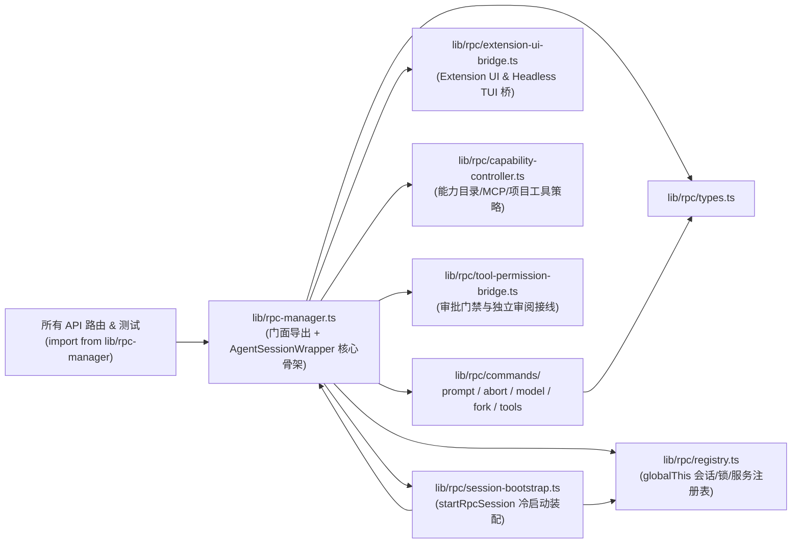

# `lib/rpc-manager.ts` 低风险渐进式拆分规划

> 基线文件：`lib/rpc-manager.ts`（拆分前 3,217 行，顶部 140+ 行 import）<br>
> 当前状态：**已完成落地（2026-11-20）** — `lib/rpc-manager.ts` 已瘦身为 30 行兼容门面，原逻辑按本规划拆入 `lib/rpc/` 下的 11 个单职责源码模块 + 2 份新增单元测试，外部调用方 0 改动。<br>
> 目标：在不破坏任何外部调用方、不改动运行时语义与竞态不变量的前提下，将核心上帝文件逐步拆解为清晰的领域模块，并建立可复用于 `desktop/src/main.ts`、`hooks/useAgentSession.ts`、`components/ModelsConfig.tsx` 的安全重构范式。

---

## 1. 为什么先拆 `lib/rpc-manager.ts`？

对比当前最痛的两个 3,000+ 行后端/主进程大文件：

| 维度 | `lib/rpc-manager.ts`（3,217 行） | `desktop/src/main.ts`（3,440 行） |
| --- | --- | --- |
| 业务核心度 | **最高**：每一条消息、模型切换、审批、工具、扩展、工作流、Team 必经之路 | 高：Electron 壳层生命周期、多窗口与 IPC |
| 现有测试护城河 | **极强**：直接关联 6+ 份秒级可跑的 Node 单元测试与行为测试 | 中：多数涉及 Electron 窗口/原生 API，需打包或桌面 E2E 验证 |
| 内部切分自然度 | **极高**：已有明显的内聚边界（Extension UI 370 行、启动装配 335 行、注册表 270 行、`send()` 812 行） | 高：但大量模块级 `let` 状态（窗口引用、托盘、桌宠坐标）交叉读写 |
| 回归风险与验证速度 | **最低、最快**（`node --test` 数秒验证） | 中等（需额外跑 desktop build 与桌面冒烟） |

**结论**：先拿 `lib/rpc-manager.ts` 做第一刀，风险最低、对掌控核心架构的收益最大；跑通这套“门面保兼容 + 逐相抽离”流程后，再按同一模板拆 `desktop/src/main.ts` 与 `components/ModelsConfig.tsx`。

---

## 2. 现状解剖：这 3,217 行到底塞了什么？

| 区块 | 当前行号范围 | 行数 | 实际职责 | 耦合度评估 |
| --- | --- | ---: | --- | --- |
| **A. 类型与常量** | `L143–L210` | ~68 | `AgentEvent`、`RpcSessionStartOptions`、UI/Command 内部类型 | 极低，纯类型 |
| **B. 工具审批与门禁接线** | `L216–L359` | ~144 | `ToolReviewController` 懒加载、`installToolPermissions()` 劫持 `extensionRunner.emitToolCall`、审批释放 | 低，边界清晰 |
| **C. 会话能力/MCP/系统提示词管理** | `L593–L790`、`L1190–L1246` | ~255 | Capability 目录、Native MCP 同步、项目工具延迟生效队列、System Prompt 热重载 | 中，依赖 `inner` 与 `isRunning` |
| **D. 任务态/事件分发/生命周期** | `L360–L592`、`L791–L1372`、`L2185–L2244` | ~730 | 运行态快照、活动时钟、Extension 延迟绑定、工作流观察、事件广播、空闲超时、`destroy()` 与 `shutdownForFileMutation()` | 核心骨架（保留在 Wrapper） |
| **E. 巨型 `send()` 命令分发器** | `L1374–L2183` | **~810** | 一个 `switch (type)` 处理 **25 种 RPC 命令**（其中 `prompt` 242 行、`abort` 70 行、`set_model` 64 行、`steer/follow_up` 50 行、`fork` 40 行） | 中高，但命令族彼此独立 |
| **F. Extension UI 与无头 TUI 桥** | `L2246–L2614` | **~369** | `createExtensionUiContext()`、`createExtensionCommandContextActions()`、Custom TUI 渲染/输入/关闭、Pending UI 响应 | **极低（最佳第一刀）** |
| **G. 全局注册表与实时配置广播** | `L2615–L2878`、`L3215–L3217` | ~267 | `globalThis.__piSessions` / `__piStartLocks` / `__piServicesCache` / `__piStartingSessionCwds` 及 10+ 导出查询与广播函数 | 低，纯容器管理 |
| **H. 会话冷启动装配器 `startRpcSession`** | `L2879–L3213` | **~335** | 并发启动锁、profile 校验、Services/ExtensionLoadPlan 构建、模型作用域解析、包装器组装、SSH 订阅、失败回滚清理 | 中，步骤线性清晰 |

---

## 3. 目标目录结构与依赖方向

拆完之后，`lib/rpc-manager.ts` 从 **3,217 行瘦身为约 500–650 行**的“核心编排壳 + 兼容门面（Barrel）”，**外部所有 `import { ... } from "@/lib/rpc-manager"` 零改动**。



### 严格单向依赖原则
- `lib/rpc/types.ts` 不依赖同目录任何实现文件；
- `lib/rpc/extension-ui-bridge.ts`、`capability-controller.ts`、`tool-permission-bridge.ts` 只通过**窄接口（Host Adapter）**与 `AgentSessionWrapper` 交互，不反向 `import` 整个 `rpc-manager.ts`，杜绝循环依赖；
- `lib/rpc-manager.ts` 保留所有现有导出符号（`AgentSessionWrapper`、`startRpcSession`、`getRpcSession`、`invalidateServicesCache`、`refreshLiveToolApprovals` 等），确保 100% 向后兼容。

---

## 4. 绝对不能破坏的 6 条红线（Invariants）

在任何一个拆分 Phase 中，必须守住以下经过线上和历史测试验证的不变量：

1. **`globalThis` 热更新键名不可变更**：`__piSessions`、`__piStartLocks`、`__piServicesCache`、`__piStartingSessionCwds` 键名必须原样保留（部分测试和 `rpc-running-status.ts` 直接读取 `globalThis.__piSessions`）。
2. **`fork` 后必须立刻 `destroy()`**：`AgentSession.fork()` 会原地改变 SDK 内部 `sessionId`，释放顺序（`finishPromptRun` → `destroy`）不可调换。
3. **启动失败清理栅栏**：`startRpcSession` 任一阶段失败时，必须清理 `servicesCache`、触发 `session_shutdown` 并 `dispose()`，且不能留下半初始化的会话历史或锁。
4. **`abortGeneration` 竞态保护**：异步 prompt 准入（refresh model / pending model / preflightResult）与 `abort()` 之间的代次比较和 `stoppedInputRecovery` 落盘顺序不得改变。
5. **文件变更互斥与排空**：`assertSessionNotMutating`、`drainSessionFileOperations`、`shutdownForFileMutation` 的顺序不可省略。
6. **不删除、不降级任何测试断言**：只能新增针对新子模块的单元测试，既有测试必须原样全绿。

---

## 5. 分 6 阶段低风险执行计划（每个 Phase 独立提交）

> **固定验证命令**（每个 Phase 完成后必跑）：
> ```bash
> node --test lib/rpc-manager.test.mjs lib/rpc-manager-behavior.test.mjs lib/rpc-startup-cleanup.test.mjs lib/rpc-startup-sdk.test.mjs lib/rpc-task-activity.test.mjs lib/rpc-workflow-extensions.test.mjs
> npm run typecheck
> ```

### Phase 1：抽离 Extension UI & 无头 TUI 桥接（最安全的第一刀）
- **目标文件**：`lib/rpc/types.ts` + `lib/rpc/extension-ui-bridge.ts`
- **抽离范围**：`L143–L210`（共享类型）+ `L2246–L2614`（UI 响应管理、Custom TUI 渲染/键盘输入、`createExtensionUiContext`、`createExtensionCommandContextActions`）+ 对应私有字段（`pendingUiRequests`、`pendingUiResponses`、`activeCustomUis`、`extensionStatuses`、`extensionWidgets`）。
- **设计方式**：创建 `class ExtensionUiBridge`，构造函数接收窄 Host 回调 `{ sessionId, emit, sendCommand, getInner, getSubagentSignal }`。`AgentSessionWrapper` 只保留一个 `private readonly uiBridge` 字段并转发 `getPendingUiRequests()`、`resolveExtensionUiResponse()`、`handleExtensionUiInput()`、`cancelAll()`。
- **预期收益**：立减 **~430 行**，且这块逻辑几乎不涉及并发竞态，回归风险接近 0。
- **额外验证**：补充 1 份 `lib/rpc/extension-ui-bridge.test.mjs` 覆盖 confirm/select/timeout/custom TUI 取消路径。

### Phase 2：抽离全局注册表与实时广播函数
- **目标文件**：`lib/rpc/registry.ts`
- **抽离范围**：`L2615–L2878`、`L3215–L3217`（`getServicesCache`、`invalidateServicesCache`、`reloadLiveModelRetrySettings`、`reloadLiveCompactionSettings`、`getLiveProjectNativeMcpCatalog`、`applyProjectToolSettingsToLiveSessions`、`reloadAllNormalSessionSystemPrompts`、`getRegistry`、`getLocks`、`getRpcSession`、`hasBusyRpcSessionForCwd`、`destroyRpcSessionsForCwd`、`getUnpersistedSessionInfos`、`stopRpcSessionsForFileMutation`、`refreshLiveToolApprovals`）。
- **设计方式**：`registry.ts` 持有全部 `globalThis.__pi*` 存取封装（不改键名），`lib/rpc-manager.ts` 通过 `export { ... } from "./rpc/registry"` 原样 re-export。
- **预期收益**：再减 **~270 行**，全仓库对会话注册表的访问第一次拥有了独立、清晰的服务容器边界。
- **注意陷阱**：`rpc-running-status.ts` 也直接引用了 `globalThis.__piSessions`，保持键名与类型声明一致即可无缝衔接。

### Phase 3：抽离工具审批门禁接线
- **目标文件**：`lib/rpc/tool-permission-bridge.ts`
- **抽离范围**：`L217–L359`（`ToolReviewController` 封装、`refreshToolApprovals`、`releaseToolApprovals`、`installToolPermissions`）+ `send()` 中 `get_tool_permission` / `set_tool_permission` 分支。
- **设计方式**：封装 `class ToolPermissionBridge`，集中处理 `permissionRunners`、`reviewModel`、父子 subagent 权限继承与人工/模型审阅拦截。
- **预期收益**：再减 **~170 行**，安全审批逻辑从会话核心中完全显性化，后续排查审批问题只需看这一个文件。
- **额外验证**：同步跑 `node --test lib/tool-permission-*.test.mjs lib/tool-review-*.test.mjs`。

### Phase 4：抽离会话能力、Native MCP 与项目工具策略控制器
- **目标文件**：`lib/rpc/capability-controller.ts`
- **抽离范围**：`L593–L764`（`refreshCapabilityCatalog`、`isToolAllowedByCapability`、`isMcpResourceServerAllowed`、`refreshNativeMcpCapabilities`、`applySessionCapabilities`、`reapplySessionCapabilities`、`applyProjectCapabilitySettings`、`flushPendingProjectCapabilitySettings`、`updateSessionCapabilities`）+ `send()` 中 `get_tools` / `get_capabilities` / `set_tools` / `set_capabilities` / `set_team_tools`。
- **设计方式**：封装 `class SessionCapabilityController`，统一收口“会话工具白名单 + 项目工具策略延迟生效 + Team 工具上限天花板 + Native MCP 同步”。
- **预期收益**：再减 **~300 行**，消除 `rpc-manager.ts` 中最晦涩的一块策略计算状态。
- **额外验证**：同步跑 `node --test lib/session-capabilities*.test.mjs lib/project-tool-*.test.mjs lib/native-mcp*.test.mjs`。

### Phase 5：拆解 810 行的巨型 `send()` 方法
- **目标目录**：`lib/rpc/commands/`
  - `prompt-command.ts`（`L1383–L1681`：prompt 准入、模型刷新、图片校验、工作流准备、模型回退执行、收尾清理）
  - `abort-command.ts`（`L1683–L1752`、`L2100–L2110`、`L2168–L2178`：abort / abort_compaction / abort_bash）
  - `model-command.ts`（`L1757–L1820`、`L1869–L1892`：set_model 含超窗自动压缩、set_thinking_level、compact）
  - `fork-command.ts`（`L1822–L1867`：fork + navigate_tree）
  - `queue-command.ts`（`L1919–L1968`：steer / follow_up 队列准入与回执）
  - `session-meta-commands.ts`（`get_commands`、`reload`、`bash`、`workflow_configure`、`workflow_action` 等轻量命令）
- **设计方式**：给 `AgentSessionWrapper` 定义一个内部 `RpcCommandHost` 上下文接口，把 `send()` 缩减为一个 **~40 行的清晰路由分发器**（通用前置检查 → 按 `type` 委托对应 handler）。
- **预期收益**：再减 **~760 行**，彻底消灭全项目最难阅读的 810 行巨型 `switch`。
- **注意陷阱**：`prompt-command.ts` 与 `abort-command.ts` 共享 `abortGeneration`、`promptTasks`、`activePromptRun`、`queuedInputReceipts` 等状态，务必先跑完 Phase 1–4、在文件大幅瘦身后再做这一步，避免同时处理过多状态引用。

### Phase 6：抽离 `startRpcSession()` 冷启动装配器
- **目标文件**：`lib/rpc/session-bootstrap.ts`
- **抽离范围**：`L2879–L3213`（冷启动流程可进一步拆为 4 个内部纯步骤函数：`prepareSessionManager` → `ensureSessionServices` → `resolveStartupModelAndCreateInner` → `wireWrapperAndRegister`）。
- **设计方式**：`lib/rpc-manager.ts` 保留 `export { startRpcSession } from "./rpc/session-bootstrap"`。
- **预期收益**：再减 **~335 行**，启动阶段的“服务创建 / 模型选择 / 能力恢复 / 失败回滚”四个步骤一目了然。

### 拆分前后体量对照（实测结果）

| 模块 | 拆分后行数 | 职责 |
| --- | ---: | --- |
| `lib/rpc-manager.ts` | **30 行**（原 3,217 行） | 公开兼容门面（保留全部原有导出符号，外部调用方 0 改动） |
| `lib/rpc/types.ts` | 84 行 | 共享事件、UI、启动选项与常量类型 |
| `lib/rpc/registry.ts` | 254 行 | `globalThis.__pi*` 全局会话/锁/服务注册表与实时设置广播 |
| `lib/rpc/tool-permission-bridge.ts` | 149 行 | 工具审批门禁、独立模型审阅与父子 subagent 权限接线 |
| `lib/rpc/capability-controller.ts` | 341 行 | 会话能力目录、Native MCP、项目工具延迟生效策略、Team 工具上限 |
| `lib/rpc/extension-ui-bridge.ts` | 461 行 | Extension UI 请求响应与无头 Custom TUI 桥接 |
| `lib/rpc/session-bootstrap.ts` | 419 行 | `startRpcSession()` 冷启动装配与失败清理回滚 |
| `lib/rpc/session-wrapper.ts` | 1,321 行 | `AgentSessionWrapper` 核心生命周期、事件订阅、运行态投影与命令分发 |
| `lib/rpc/commands/host.ts` | 77 行 | 命令处理器窄宿主接口 |
| `lib/rpc/commands/prompt-command.ts` | 400 行 | `prompt` / `steer` / `follow_up` 预检、回退与队列准入 |
| `lib/rpc/commands/abort-command.ts` | 110 行 | `abort` / `abort_compaction` / `abort_bash` |
| `lib/rpc/commands/model-command.ts` | 100 行 | `set_model`（含超窗压缩）、`set_thinking_level`、`compact` |
| `lib/rpc/commands/session-commands.ts` | 181 行 | `fork`、`navigate_tree`、`reload`、`bash`、`workflow_*` 等会话命令 |
| **新增单元测试** | 175 行 | `lib/rpc/extension-ui-bridge.test.mjs`、`lib/rpc/registry.test.mjs` |

---

## 6. 给 AI 执行每个 Phase 时的标准指令模板

以后每次你准备让 Codex / AI 落地其中一个阶段时，直接按下面模板下达指令，就能牢牢把控变更半径：

```text
请严格按照 docs/REFACTOR_PLAN_RPC_MANAGER.md 中的【Phase X】执行拆分：
1. 仅限纯结构重构，不改变任何外部行为、错误文案、事件时序或 globalThis 键名；
2. lib/rpc-manager.ts 必须保留所有原有导出符号，不得修改任何外部调用方；
3. 严禁修改、删减或放宽任何现有测试断言；
4. 完成后运行 Phase X 指定的 node --test 用例与 npm run typecheck，并列出改动文件清单与每个文件的职责边界。
```

---

## 7. 后续同类大文件的拆分优先级建议

完成 `lib/rpc-manager.ts` 后，可按同样“**门面保兼容 + 逐相抽离**”范式依次推进：

1. **`desktop/src/main.ts`（3,440 行）**：拆为 `desktop/src/main/` 下的 `state.ts`（共享窗口/服务状态）、`ipc-handlers.ts`（24+ IPC 按域拆分）、`companion-windows.ts`（`L1860–L2358` 约 500 行桌宠窗口与运动逻辑，最独立，适合当第一刀）、`updater-controller.ts`（`L669–L965` 约 300 行）、`tray-and-menu.ts`（`L966–L1136` + `L2470–L2550`）。
2. **`components/ModelsConfig.tsx`（3,511 行）**：拆出 OAuth 登录状态机 Hook、Provider 卡片列表、自定义模型编辑弹窗与 Limit 校验表单。
3. **`hooks/useAgentSession.ts`（3,323 行）**：拆出 `useSessionHistory`（分页与预取）、`useAgentEventStream`（SSE 连接/重连/delta 解码）、`usePromptRecovery`（IndexedDB 防丢与磁盘回执核对）。
