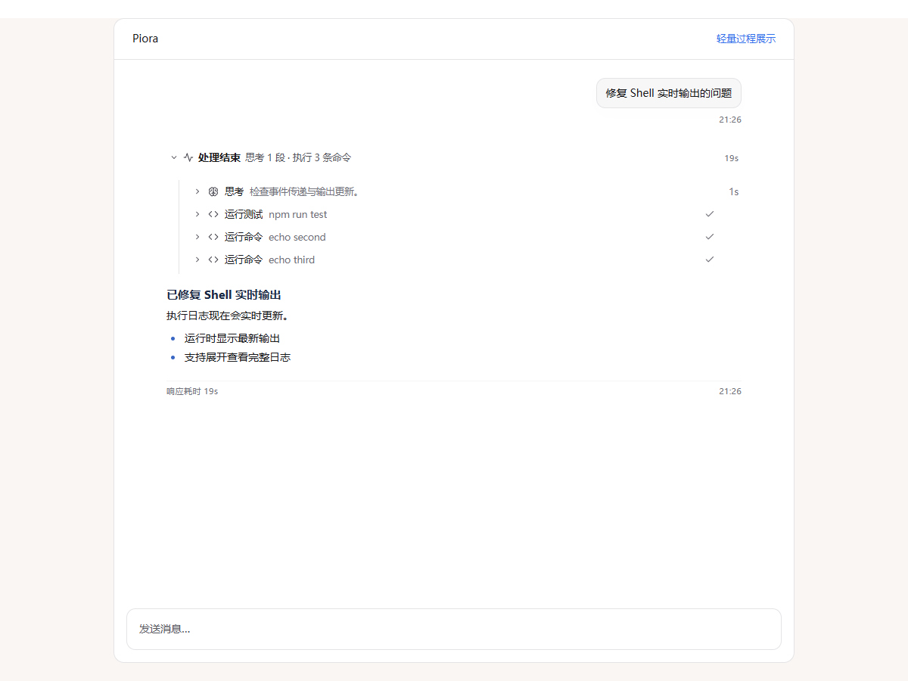
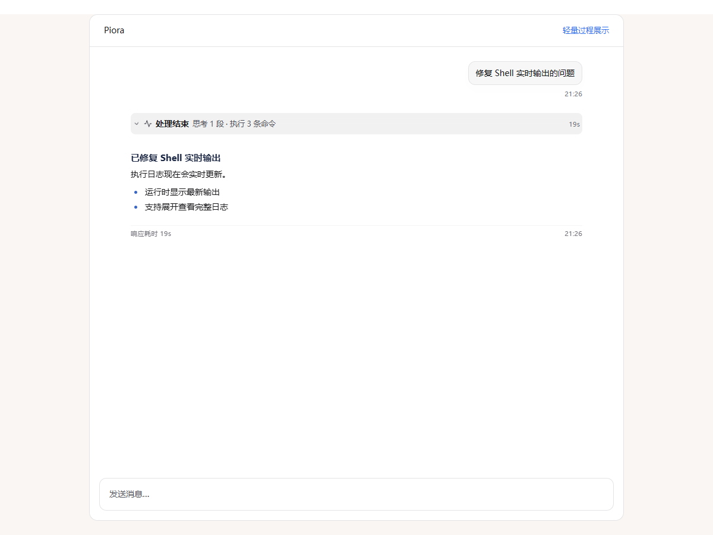

# 聊天过程折叠

对应 [#217](https://github.com/kexijiang/Piora/issues/217)。普通模式与轻量模式使用同一份整轮展示计划，不改写原始会话记录。

- 每次用户输入对应一个过程入口，汇总思考、读取、搜索、命令、修改和其他工具次数。上下文压缩不会切断这一轮。
- 正文说明、图片、最终回答与自定义提示保持原始顺序；只有思考和工具步骤受总入口控制。展开后直接展示步骤，单条详情独立展开。
- 普通模式运行时展示步骤；轻量模式默认展示最近三个步骤摘要。当前轮完成后默认展开，下一次用户输入才自动收起。
- 用户手动选择覆盖默认状态，查看日志等操作也会保留整轮展开。失败、停止、缺失结果和需要用户接管的过程保持展开，避免隐藏处理依据。
- 思考的流式预览随最近完成的段落首行更新。历史思考保留原始块索引，搜索跳转先展开对应过程再定位消息。
- 手动折叠以点击控件的位置为阅读锚点，配合虚拟列表测量保持阅读位置。

## 完成后保留步骤



## 手动收起



截图使用合成测试会话，可通过以下命令重新生成原始截图：

```powershell
$env:PIORA_COMPACT_SCREENSHOTS = '1'
node --test components/CompactProcess.browser.test.mjs
```

原始截图位于 `test-results/compact-process/`；上方示例分别对应 `auto-completed.png` 与 `completed.png`。
