# 群聊 UX 改版与验收

状态：2026-10-17 群聊功能、视觉、真实模型任务、Electron 渲染与进程重启验收通过。未执行本地发布打包；以下区分夹具检查与真实运行证据。

## 视觉基准

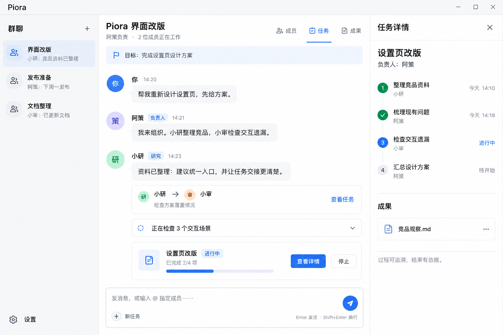
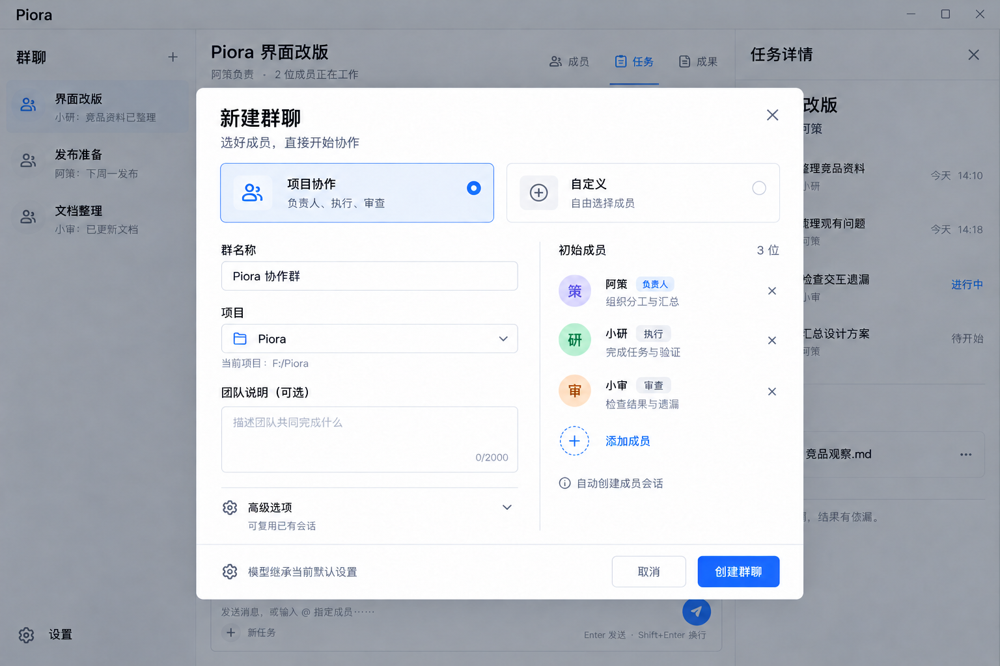
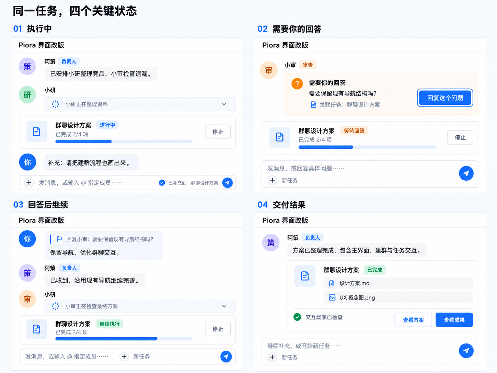

## 竞品依据与设计取舍

以下为官方公开材料核对，未将未登录体验或推测写成实测结论。

| 对标 | 可核实体验 | Piora 的设计选择 |
| --- | --- | --- |
| [Grok Bot](https://x.ai/bot) | 像同事一样发消息，多 Bot 并行；同一话题内可交接工作 | 单一群聊输入框、稳定成员身份、交接卡；负责人组织，成果回到群中 |
| [Telegram Bot](https://core.telegram.org/bots/faq) | 群内定向消息与回复决定机器人接收上下文 | 使用稳定 ID 提及、明确回复目标；问题必须按当前问题代次回答 |
| [Slack AI](https://slack.com/help/articles/25076892548883-Guide-to-AI-features-in-Slack) | 在频道、私聊与话题中快速回顾上下文 | 话题局部讨论、结论同步、任务及成果详情按需展开 |

以上最后一列是本方案的产品判断。共享云电脑、自动化日程等竞品能力不属于本次群聊重构范围。

## 产品合同

- 单用户与多智能体的项目群；稳定成员身份，一个负责人。
- 侧栏群名、最近消息、置顶、未读与需处理状态；固定置顶优先，其余按最近活动排序。
- 群头部显示负责人和真实活动；成员、任务、成果共用右侧详情，窄屏抽屉。
- 普通消息左对齐，工具过程默认收起；任务、交接、问题、成果结构化呈现。
- 一个输入框。未指定成员的普通消息由所有成员独立进行无工具的接手判断，比较适合程度后选出一名处理人；同分优先负责人，群中显示每位成员的简短理由及最终人选。简单问答直接回复，实际工作继续使用 TeamRun。
- 判断结果与最终人选持久保存；刷新、重试或重启复用已完成判断及派发标识。评估阶段不执行用户任务，不阻塞同群其他消息。部分成员失败可由完成判断的合适成员接手；全部失败保留原文供重试；全员不认领时只选一名澄清联系人，不直接创建执行任务。
- 活跃任务中的普通消息补充当前任务；新任务显式创建并按顺序排队。
- 稳定 ID 提及，单独提及定向，多成员由负责人组织，群体征询有界。
- 回复绑定消息/成员/话题/问题；只有显式关联的问题回答可以恢复等待任务。
- 执行中可补充、停止、继续和重试，控制范围只覆盖该群任务拥有的命令。
- 话题保留局部讨论，关键结论可同步回群。
- 成果可打开并返回来源，完成必须有真实运行状态与验证证据。
- 无历史会话也可模板建群；默认负责人/执行/审查，自动名称、当前项目、继承默认模型。
- 自定义成员与复用会话，高级配置渐进展开；初始化幂等，失败可重试。
- 消息先持久化回执；草稿、发送恢复与幂等重试；断线/刷新/重启恢复。
- 旧接口、历史消息、手动编排兼容；复用 Room/TeamRun/SessionMessageRouter/worktree。

## 验收记录

- [x] 主界面与三张图相符：头部、交接、任务卡、统一输入、右侧详情。
- [x] 1440、820、390 像素宽度截图并由实现者逐张查看；深色主题。
- [x] 模板/自定义创建、零历史会话界面检查；真实 Room 存储配合注入的会话初始化边界验证部分失败重试，未实际调用提供商。
- [x] 普通提问/任务/补充/显式新任务队列。
- [x] 提及同名、名称包含、重命名、中文标点边界。
- [x] 问题关联正确，无关消息不恢复；回复与话题。
- [x] 执行中补充、停止、重试/恢复的隔离状态机与 Router 合同验证；真实任务另验证原任务重试、独立审查与交付。
- [x] 成果打开、来源定位、最终交付去重。
- [x] 草稿与恢复：新输入不覆盖、重试幂等、页面刷新、磁盘回执与 SSE 对账；真实服务进程重启后复核任务、审查、回执、成果和唯一交付。
- [x] 长消息、并行流式、历史滚动、中文输入法与键盘操作。
- [x] 本次涉及文件 ESLint、92 项 Room/TeamRun 回归、42 项 RPC 行为检查与 21 项浏览器交互检查通过，包括新增独立进程恢复检查。
- [x] 完整 TypeScript 检查：恢复 desktop 文件及依赖后，根项目 `tsc --noEmit` 与桌面 `tsc -p desktop/tsconfig.json --noEmit` 均通过。
- [x] 实际 Electron 主进程、preload 和群聊页面；真实 Codex 模型执行与独立审查；真实服务进程重启实机验收。
- [x] 无真实模型副作用的隔离运行验收，明确区分夹具测试和真实提供商测试。

## 验证方式与材料

- `node --test` 执行 Room/TeamRun 测试（正文排版浏览器检查单列）：92 项通过，0 失败；RPC 行为检查 42 项通过。
- `node scripts/verify-group-chat-ux.mjs`：实际生产 React 组件与 CSS，API/SSE 使用隔离夹具，21 项检查通过；不启动真实 Agent、不消耗提供商额度。
- 长内容排版测试使用生产 `RoomWorkspace`，在明暗主题、1440/390 宽度比较主对话与群聊正文，检查代码、表格、折叠过程、流式最终去重。
- 截图覆盖桌面主界面、建群、问题、失败恢复、交付、820 抽屉、390 主界面与抽屉、深色主题；已逐张打开检查。群聊列表更新为双人群组图标。
- 完整日志与所有截图：`.verification/group-chat-ux/`。视觉基准原图与已实现截图均保留，避免将生图概念稿误当成功能截图。

### 早期真实运行与重启边界复核（阻塞已在下文解决）

- `npm run dev` 实测在 `predev → brand:prepare` 失败：缺少既有删除的 `desktop/build/piora-icon.svg`。
- 为确认是否仅预启动脚本受影响，单独启动 Next 开发服务器进行诊断，真实 HTTP 首页返回 500；`instrumentation.ts → lib/app-backup.ts` 无法解析 `desktop/src/clipboard-database`。诊断服务已停止，未将这种启动方式当成通过验收。
- 补充问题回答崩溃边界：恢复事件携带回答消息的持久关联；模拟“任务恢复已经落盘、最终发送回执尚未写完”，由独立 Node 进程重读磁盘并恢复回执。验证送达只确认一次，后续问题仍保持等待，不会被旧回答恢复。
- 上述进程测试覆盖群消息恢复边界，不等同于完整 Electron 应用重启或真实模型验收；完整运行仍未通过。
- 停止请求先写入事件日志、撤销任务租约，成员确认取消后才转为已停止并推进队列；失败保留停止意图，拒绝继续/迟到写入，重启会重试原任务拥有的命令。已验证取消失败、队列阻塞、重启恢复及重试界面，并打开检查新增截图。
- 成员命令事件扫描改用有效群聊目录清单，跳过 `.creation` 等恢复元数据目录；包含“先建群，再接收成员事件”的回归场景。

### desktop 缺失修复与真实页面验证（2026-10-17）

- 用户授权修复后，从当前 Git HEAD 恢复 60 个处于未提交删除状态的 desktop 文件；未覆盖其他现存文件。Git 无法追溯由哪个本地进程执行删除。
- 按桌面包固定版本补装依赖，Electron 可执行程序版本为 43.7.7。根项目与桌面类型检查通过。
- 原 Next 开发缓存存在损坏的生成类型文件，已备份到 `.verification/group-chat-live/next-dev-before-repair/` 并重新生成，未运行 next build。
- 正常 `npm run dev` 预启动及首页访问通过；真实 Next 服务返回 200，浏览器打开建群弹窗，未捕获页面运行错误。使用隔离数据目录，不使用 API/SSE 夹具，不调用真实模型；测试服务已停止。
- 修复证据：`.verification/group-chat-live/desktop-repair-report.json`、`runtime-report.json`、`home.png`、`create.png`。以上解决了原文件缺失阻塞，不代表完整模型与 Electron 实机验收已完成。

### 最终真实验收（2026-10-17）

- 使用隔离工作目录、独立 Room/Agent 数据和实际 API/SSE，从真实页面创建三名成员；没有注入模型或接口夹具。
- 默认通义模型返回 `403 AccessDenied.Unpurchased`，现有 DeepSeek 凭据返回 `401`；未将账号拒绝记为通过，未改动用户的全局模型配置。使用现有 Codex 登录与 `gpt-6-luna` 完成后续真实验收。
- 修复继承编码工具的成员缺少 `piora_room`、会话恢复遗漏协作工具、模型不可见验证依据 ID，以及被拒绝的汇总污染最终交付等真实运行问题。复用会话仅在所属群消息接待时启用协作工具，仍遵守项目工具限制。
- 原任务 `d43e03fd-addb-4b8e-985a-518baa2042bc` 经实际界面重试后完成，执行成员读取资料、生成并重读报告，另一位审查成员独立核对后批准。交付携带成果和验证依据，刷新后只有一份。
- 停止并重新启动实际 Next 服务后，审查决定、最终成果 ID、持久发送回执与唯一交付一致；从成果下载 API 取得报告，内容包含资料中独有的验收标记。
- 实际 Electron 43.7.7 加载主界面及群聊，preload/应用壳/Markdown 渲染检查通过，截图经实现者打开查看，正常退出码为 0。使用开发运行时与独立桌面配置，不代表安装包发布验证。
- 真实 1440 桌面、任务详情、390 窄屏与深色截图均已查看；长目标可展开，执行列表及成果保留可见空间。开发服务导航/退出时有 `ERR_ABORTED` 资源取消日志，未发生群聊页面脚本异常。
- 证据：`.verification/group-chat-live/model-e2e-report.json`、`restart-report.json`、`electron-report.json` 及同目录截图；夹具交互结果在 `.verification/group-chat-ux/report.json`。
- 验收服务及 Electron 测试进程已结束，临时目录中的四份提供商凭据副本已移除；保留报告、转录及成果，用户原有凭据和默认模型未改动。最终根项目/桌面类型检查、涉及文件 ESLint 与 `git diff --check` 均通过。

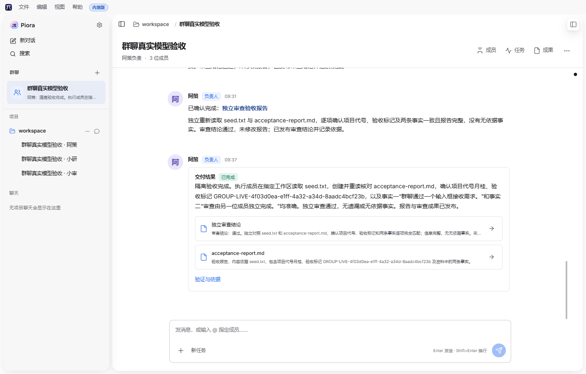
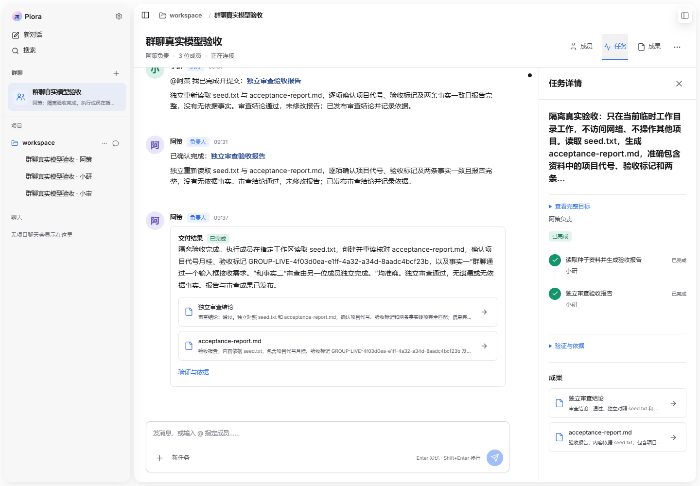
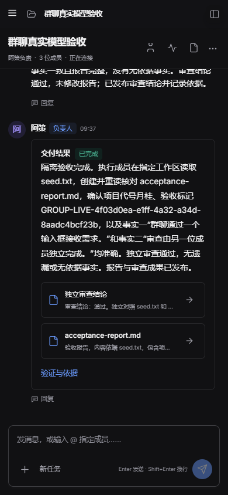

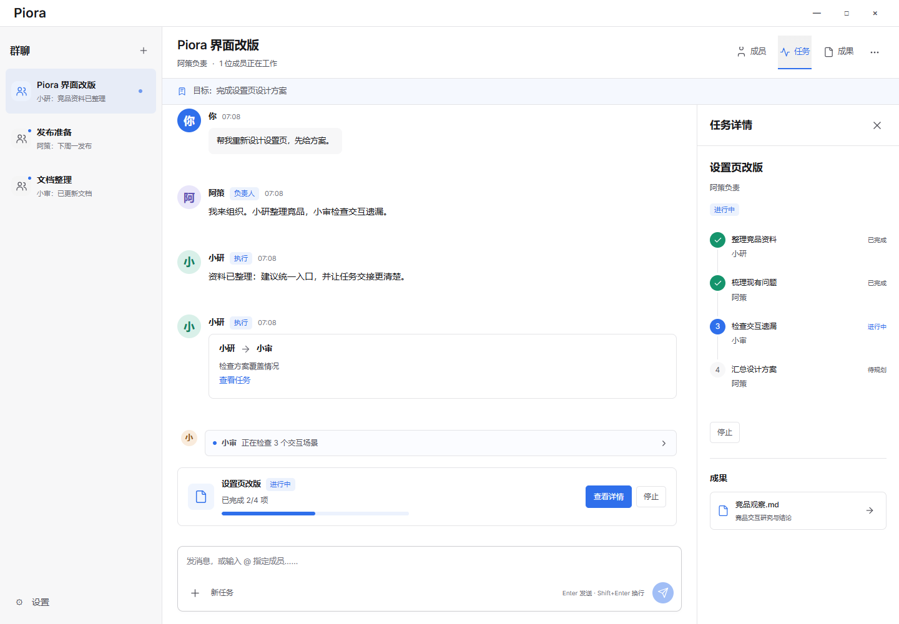
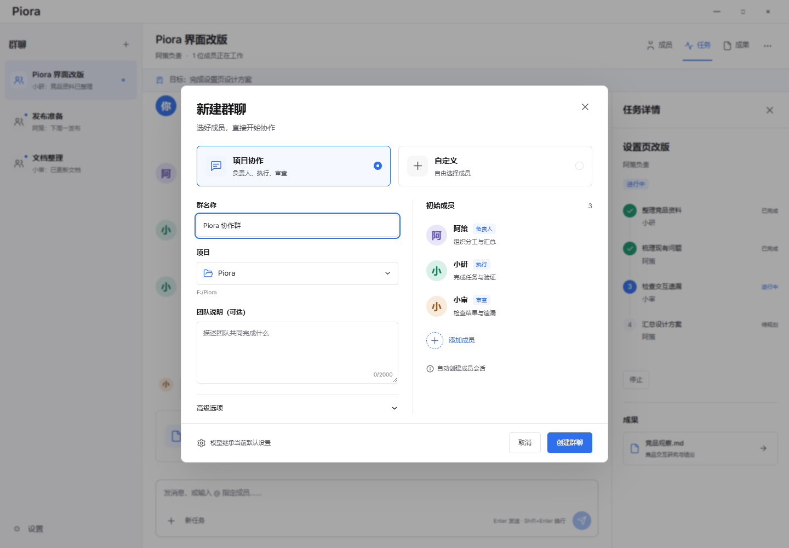
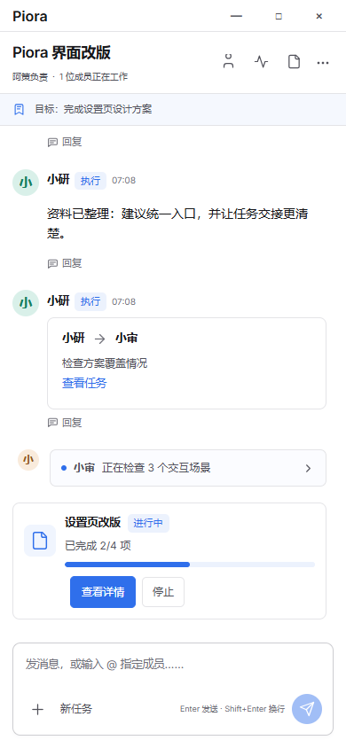
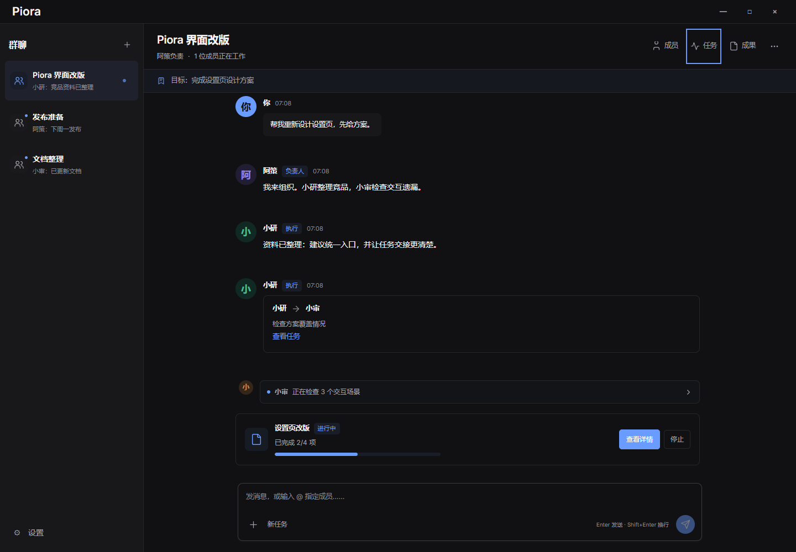
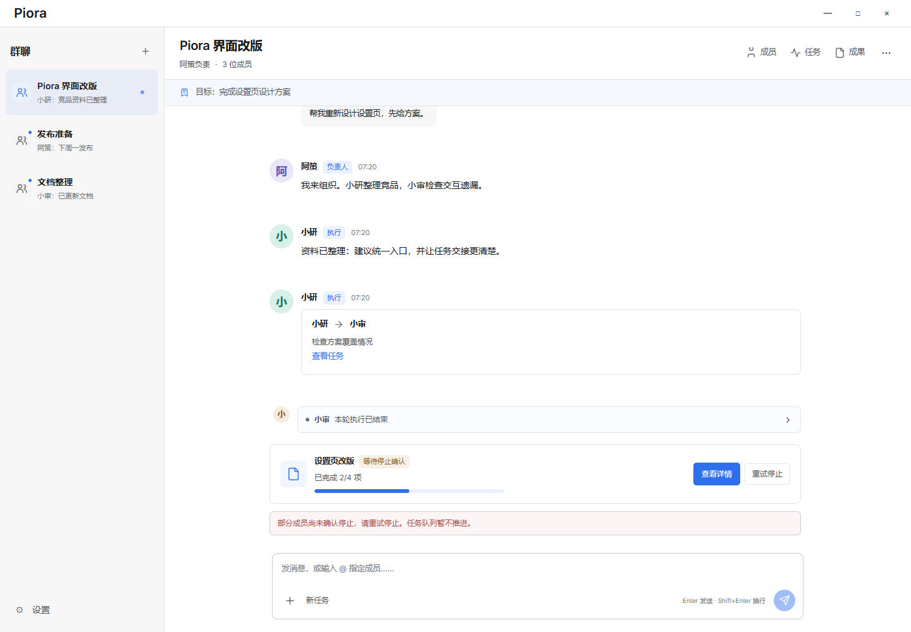

## 工程约束

保留工作区原有未提交修改；不本地打发布包，不运行 next build。验收材料保存到 `.verification/group-chat-ux/`。
