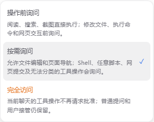

# 聊天工具权限

输入框底部可选择操作前询问、按需询问或完全访问。设置 > 通用控制新聊天的默认模式，初始为按需询问。

权限按聊天 ID 保存在 `<agentDir>/piora/tool-permissions/<sessionId>.json`，不随历史分支回退，不受 AgentSession 空闲回收影响。分叉及复制聊天使用当前的新聊天默认模式，不继承父聊天的完全访问。旧聊天没有记录时显示旧版兼容权限：普通工具保持原行为，桌面浏览器脚本仍逐次确认。用户选择任一模式后结束兼容行为。

统一入口在 SDK ExtensionRunner 的最终 tool_call 分发之后判断，覆盖模型直接调用和工具通过 SDK 调用的子工具；扩展对参数的修改先于判断，已有阻断不会被完全访问覆盖。运行时重载会重新安装入口。

操作前询问允许 read/grep/find/ls、用户提问以及浏览器观察直接执行。按需询问额外允许 write/edit 和明确的浏览器导航。Shell、任意 JavaScript、点击/输入/按键及未知扩展工具没有可靠的结构化副作用信息，因此保守询问；不通过关键词把任意代码猜测为安全操作。完全访问跳过工具审批，不跳过普通扩展提问、用户接管或执行正确性检查。这是应用级审批机制，不是文件系统沙箱或恶意扩展隔离。

权限审批携带独立的 toolApproval 标识，并使用已有的请求 ID、SSE 重连恢复、取消和超时机制。批准仅绑定一个请求；批准期间若权限版本变化，重新判断。开启完全访问只释放待处理的工具审批，不回答其他问题。已进入执行阶段的操作不回滚，后续调用读取最新权限。

桌面浏览器执行 JavaScript 仍检查标签页归属和导航令牌。显式权限模式下由统一入口审批；完全访问可通过敏感页面脚本检查，桌面进程直接读取同一份持久化记录，模型不能提供 full 标志。密码输入、验证码及用户接管流程不自动完成。

新增工具默认按未知操作处理；需要免询问时应为其结构化动作建立明确分类并补充测试，不能仅凭工具名称推断外部副作用。
