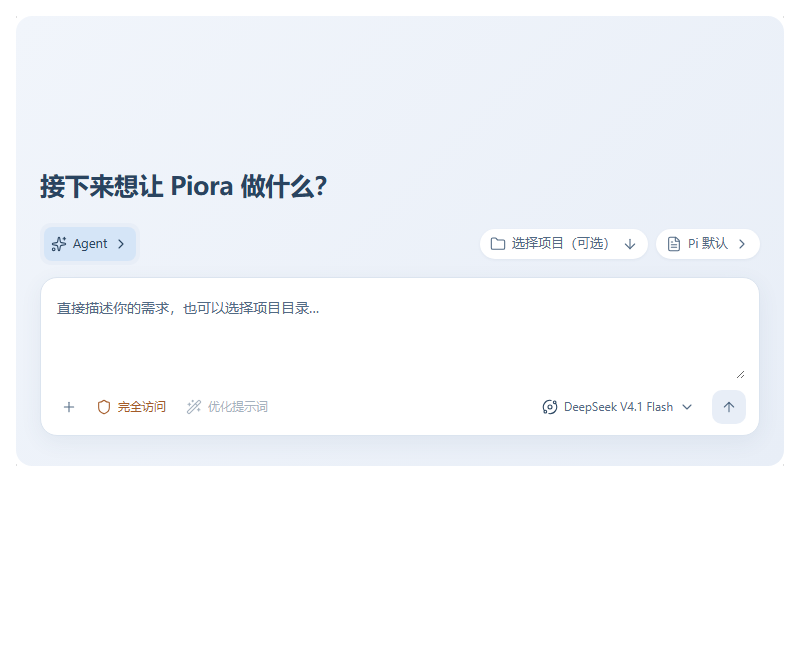
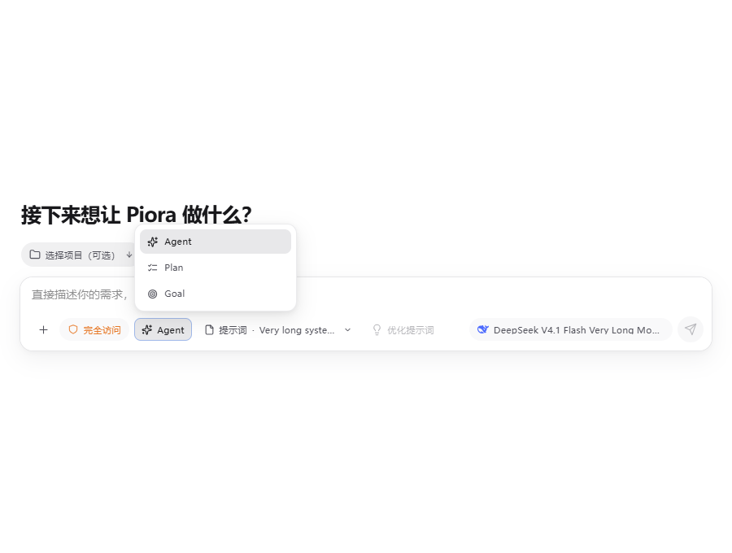
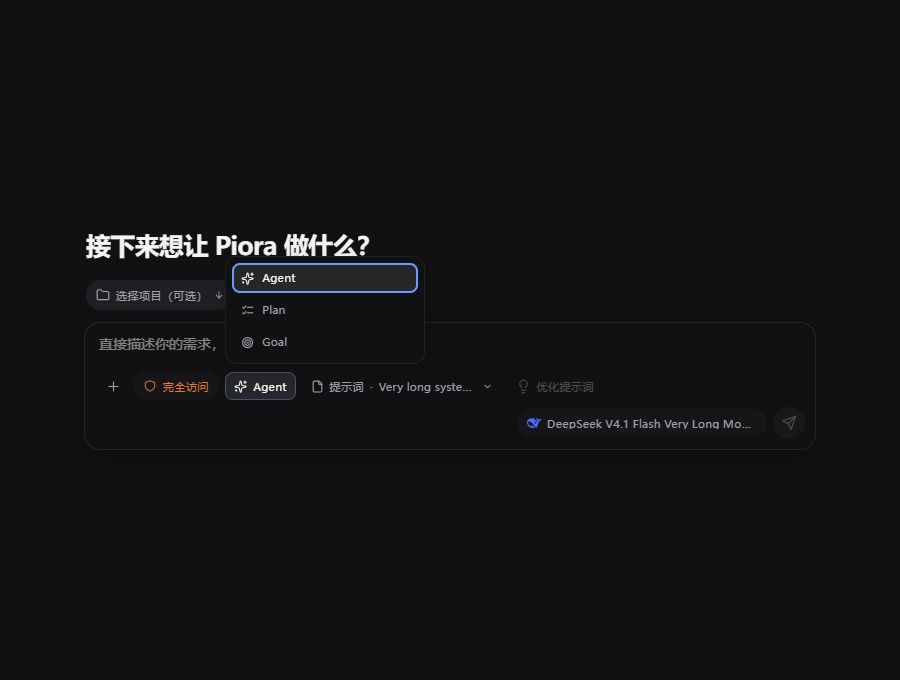

# 输入区模式选择与工作流操作条

对应 [issue #394](https://github.com/kexijiang/pi-desktop/issues/394)。以下规则按 2026-11-15 的桌面反馈更新，覆盖模式选择位置、弹层交互和 Plan / Goal 操作条。

上图保留为历史参考；模式位置和收起规则以本文最新说明为准。项目、模板和模型数据均为示例。实际实现使用应用现有主题、字体、背景与控件，不照搬预览的顶部留白。

## 布局

- 移除欢迎标题上方重复的“新任务”小标签，降低标题字号。
- 模式选择下放到输入框底部工具栏：附件 → 权限 → 当前模式（及 Goal 轮次）→ 会话提示词 → 优化提示词；模型和发送保持在右侧。会话输入框上方不再为模式单独保留一行。
- 新任务与普通会话、项目内会话使用相同的底栏顺序：权限 → 模式 → 系统提示词 → 优化提示词。新任务的项目选择单独保留在输入框上方左侧，项目和提示词沿用原选择器交互。
- 附件、权限、优化提示词、模型和发送入口保持直接可见。窄面板有序换行，不新增“更多”或“任务设置”入口。
- 项目选择始终居左，实验室 Plan / Goal 开关只控制模式入口是否显示，不再改变项目对齐。窄面板按相同顺序换行，不为弹层保留多余横向空白。
- 模式按钮仅占用图标和当前名称的宽度，Goal 轮次预算紧跟按钮。长名称、字体放大和窄面板允许必要换行；打开模式菜单不改变底栏尺寸，菜单中三个名称必须完整可读。
- 模式按钮与旁边系统提示词共用工具栏视觉规格：28px 高、8px 横向内边距、6px 图标间距和主题圆角，默认透明背景与次级文字；悬停、键盘聚焦或打开菜单时才显示高亮边框和底色，不保留独立的常驻色块。
- 展开的模式菜单与项目、提示词选择器共用选择浮层的背景、透明度、模糊、边框、阴影和主题圆角；列表使用 6px 内边距，选项保留紧凑单行，图标间距 8px、横向内边距 9px。选中行只使用主题选中底色，不叠加独立描边；保留键盘焦点提示。
- 实验室 Plan / Goal 开启时，底栏模式入口保持可见，Goal 被选中时预算也保持可见，不再与上方工作流状态联动隐藏。模型执行中或工作流操作处理中仅禁用，结束后恢复可用；沿用草稿模式和预算的保存与发送语义。
- 输入区状态条只显示仍在执行或需要用户操作的当前流程。已完成、已取消以及只有历史记录时不显示，避免新草稿切到 Goal / Agent 后仍挂着旧 Plan；保留后台记录，不因本地模式选择改写工作流。暂停、等待、预算耗尽与失败状态的继续 / 退出入口保留；失败 Plan 被明确退出、失败 Goal 被明确取消后记录为已取消，解除当前流程。实验室关闭后仍可执行退出或取消。

## 模式切换

1. 平时仅显示当前模式的图标和名称，完全移除 `>` 箭头及其占位；悬停、键盘聚焦不伸缩按钮，也不自动打开菜单。
2. 点击后在按钮上方向上弹出 Agent / Plan / Goal 菜单，三个选项直接可见。菜单使用独立浮层，在视口内避让，不推动输入框和其他工具；滚动或窗口尺寸变化后跟随触发器定位。悬停或聚焦选项时，模式说明显示在整个菜单外侧，说明层级高于该菜单，避免被遮挡或盖住其他选项。
3. 选择立即生效，鼠标仍在按钮或菜单内时保持展开。真实移出整个交互区约 **200ms** 后收回，期间移回取消收回；穿过按钮与菜单的间隙或在三个选项间移动不误关。布局移动到鼠标之外不算主动移出，避免 Goal 预算出现或工具栏换行造成误关。
4. 外部点击、Escape 或焦点移出关闭展开区，不额外改变模式。方向键移动选项焦点，Enter/Space 确认；自动收回和 Escape 合理返回触发器，Tab/外部点击不抢焦点。
5. 禁用时不可切换；禁用、关闭和卸载清理计时器。减少动态效果时关闭位移和淡入动画。键盘选择后保持展开，Tab / Escape 关闭；触屏抬手不启动鼠标移出计时。
6. Goal 的预算保持可见，沿用已有范围与发送语义；Plan 仍由用户确认执行。实验功能关闭时不显示模式入口。

实验室的 Plan / Goal 设置使用与设置页一致的圆角滑动开关：开启时使用主题强调色，白色圆点滑到右侧；关闭时恢复灰色和左侧圆点，不显示按钮文字。保存中禁用，保留键盘激活、辅助技术的开关状态和保存失败后的原状态。

## 工作流操作条与详情

- 摘要、状态和操作位于输入框上方同一工作流条。Plan 待确认时，执行计划 / 修改计划 / 退出计划在详情收起时也直接可见；主操作强调、其他操作次级，窄屏可换行，不藏到更多菜单。
- 工作流条与详情复用输入框的玻璃背景、透明度、模糊、边框、阴影与主题圆角；悬停使用透明底色，避免重新盖上不透明背景。摘要的背景单独绘制，详情仍可向上展开而不被裁切。
- 摘要 / 查看详情与操作按钮是独立点击区域，不嵌套按钮。悬停或键盘聚焦不再自动打开大段计划；点击查看、点击外部或 Escape 控制展开与收起。
- 新一版计划进入待确认时自动展开一次并保持，不抢输入焦点，也不因鼠标移出收起。自动展开去重按会话、计划和版本标识；同版手动收起后，轮询刷新或切回会话不再反复打开。
- 点击详情和操作条之外收起，保留外部目标的点击和焦点；详情内滚动、选中文字、点击按钮或编辑预算不误关。Escape 返回详情触发器。
- 执行 / 退出成功后收起；失败保留详情，在操作条中显示错误与重试入口，不被详情遮挡，也不被后台同步清除。主动刷新、再次操作或切换会话后清除旧错误。修改计划成功后聚焦原输入框，保留草稿与计划内容。
- 执行中不再显示待确认操作，停止沿用会话原有入口。Goal 暂停 / 继续 / 取消保留在工作流条，预算可在详情中调整；实验室关闭后仍能退出或取消已有流程。

## 沿用现有选择器

项目与提示词组件的行为是用户明确要求保留的部分，本轮复用原组件。

- 项目：桌面端向上弹出，横向位置在顶栏与视口内避让；保留搜索、无项目聊天、路径、打开其他文件夹和选中后的输入框焦点；移动端沿用底部弹层。
- 提示词：保留 body portal、视口边界和上下翻转、说明与预览、键盘选择和触发器回焦。
- 两者不参与模式的延迟收回，不变成输入框下面新增的一块区域。

## 验证入口

- `components/Workflow.browser.test.mjs`：真实浏览器组件交互，覆盖模式移出收起、连续改选、键盘、焦点、禁用、减少动态效果，以及工作流动作、详情展开与外部关闭。
- `components/ChatInput-layout.browser.test.mjs`：生产组件与 CSS，合成 API 数据；覆盖中英文、明暗主题、窄聊天列、字体放大、原有浮层与发送模式/预算。设置 `PIORA_COMPOSER_SCREENSHOTS=1` 可保存 `.verification/launcher-composer-ux/` 截图。
- 这些组件夹具不代表真实模型、原生文件选择器、Electron 安装包或未运行平台已验收。

### 当前组件截图（2026-11-15）

以下截图来自生产组件与主题 CSS 配合合成 API 数据的布局测试，展示新任务底栏和展开菜单的明暗主题；图中的模型和提示词名称为测试数据。

