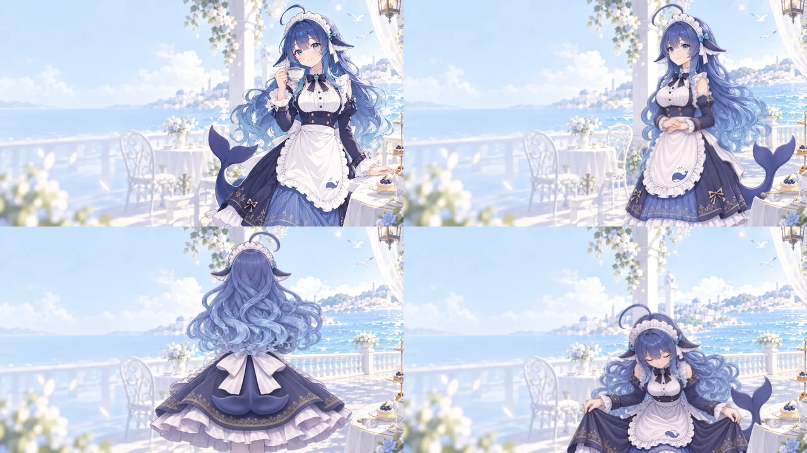

# 晴汐露台演出的绘制素材

下列提示词记录最初的露台构图参考和走步原画，角色参考取自本项目的 `whale-tide.webp`。成片固定采用举杯近景，晴汐叠手走向桌旁，转身经过背面，然后提裙行礼。[镜头素材](camera/) · [叠手短步的画稿与登记](gait/README.md) · [转身与行礼的补绘提示词](center/prompts.md)

## 最初的露台构图参考

Production background plate, no characters. Make a clean, FULL LANDSCAPE 16:9 wide establishing view of the EXACT same painted anime oceanfront café veranda in the reference art. Camera has backed up just enough and tilted down a little to see where a full length maid could actually walk across the pale stone tiles. The sea horizon, coast with white stucco houses, bright blue water, luminous cloud-filled blue sky, sunlit white terrace balustrade, white arcade with trailing hydrangea vines and airy curtains preserve the atmosphere, illustration detailing, perspective and palette of the artwork. Make an exquisitely painted but unobtrusive visual novel background with soft, breezy summer daylight; keep left airy and relatively plain. In the foreground the actual walkable tiled floor must be continuous without obstacles from x=0.10 to 0.83 of canvas, from y=0.72 down to bottom. Keep the open foyer scene light. Put ONE small elegant round white linen café table only at extreme FAR RIGHT x>.91, small porcelain gold-rimmed teacup and blueberry cake, partially cropped off the edge. Cluster blue hydrangeas at the extreme edge and hanging from columns, away from walking track. No other tables or chairs occupying floor; walkway is broad and genuinely empty. No human, whale, tail, animal, person-shaped shadow, labels, text, watermark, furniture or flowers in walking lane, foreground projection, ornamental frame or character silhouette. Wide establishing view 16:9. Render as a complete full bleed high-quality background.

## 角色关键姿势

Use case: identity-preserving illustration and professional hand-drawn video game character animation. Deliver ONE high-resolution landscape sprite sheet, 4 columns by 2 rows, eight equal cells with four separate complete figures in each row. Target 3072×2048 or larger, with true transparent RGBA background everywhere between figures. Reference image is Qingxi's precise face, hair, costume and whale-tail model sheet. Draw her as a mature-proportioned, slender, full-length anime woman (approximately seven heads tall), faithful luminous fine anime linework and exquisite soft watercolor/cel rendering. Lock her facial proportions and costume in all eight drawings: sky blue eyes, long deep blue ombre hair/light-blue tips, curved single ahoge and white frilled headdress with cyan side bow, fin-shaped blue ears, navy neck bow with blue gem, white ruffle-front bodice, fitted navy corset with gold buttons, dark fitted long sleeves with white frill cuffs, white ruffle apron with a SMALL blue whale emblem, knee-length layered navy dress with gold botanical hem, cream-white stockings, paired very dark blue Mary Jane low-heeled shoes. Her distinctive thick blue whale tail emerges behind her from the lower back and ends in two flukes with no limbs or flukes cropped. Keep individual strands and linework legible at sprite scale.

Eight sequential KEYFRAMES reading first row left to right then lower row left to right, of one coherent gentle walk traveling toward the LEFT edge of the image. Keep each character centered INSIDE her OWN imaginary cell; the world translation will be added externally. A consistent side-on camera, identical anatomy, head size, eye level and approximate foot baseline per row, with room above her hair and under each shoe. Every single figure shows BOTH complete separately readable legs AND both distinct Mary Jane shoes, including which one bears weight and which one is airborne. Show long calves below a knee-length skirt; her dress and tail trail gently to her RIGHT as she walks toward the LEFT. The cadence has true alternating foot contacts, passing and airborne phases. Keep face consistently oriented toward screen left from pose 2 onwards except the final head glance; every body walks left. Alternate the nearer and farther arm in counter-swing so foot phases read. Vary knee bends and foot silhouettes appreciably; visually distinct walk-cycle poses are essential.

1 TOP LEFT: three-quarter front, just finishing lowering her empty teacup hand to chest height after putting the cup down offscreen. Relaxed smile. Poised together feet, empty fingers. 2 TOP SECOND: turn head, shoulders and hips three-quarter LEFT, transfer weight to the far foot, the near heel lifts, bend knee for walk start; tail lags the turn. 3 TOP THIRD: facing LEFT, NEAR/foreground leg reaches far left for an unmistakable leftward heel strike, far leg clearly extended behind to the right touching on toe; far arm forward. 4 TOP RIGHT: leftward single support on the near foot flat directly below hips, FAR leg flexed behind then passing the planted calf, far heel visibly lifted at least a shoe length and knee slightly forward; torso lowers gently; shoes separated. 5 BOTTOM LEFT: opposite wide heel strike: FAR leg ahead toward screen LEFT, NEAR/foreground leg trailing far RIGHT at toe-off. Near arm clearly forward; this must be genuinely the other leg from pose 3, no mirroring of the face or direction. 6 BOTTOM SECOND: support on FAR leg while NEAR knee lifts and passes in front with near shoe visibly airborne higher than the supporting ankle, opposite arms. 7 BOTTOM THIRD: second NEAR foot lands clearly to the LEFT of the other foot, smaller braking stride, trail foot gathers and upper-body motion settles, still looking left. 8 BOTTOM RIGHT: weight settles with both feet close but separately readable on the ground, body facing three-quarter left and a small over-the-shoulder glance toward viewer, hair and tail coming to rest.

This is a production animation sheet, no vignettes, no panels, labels, lettering, shadows on ground, backdrops, teacup, saucer, props or color field. Transparent air must completely separate every figure in the grid. Each cell contains exactly one whole figure at the same scale with a clear empty gap; use compact tail and hair silhouette so it fits. Prioritize appeal, the original character's sophisticated design, and anatomically convincing leg and foot contact changes over excessive flowing fabric. No chibi, superdeformed figures, giant heads, oversized shoes or gliding duplicate legs.

## 前摆经过姿势

Precise edit of an existing hand-drawn animation frame, on fully transparent RGBA. Keep EXACTLY the same single character and exact framing and canvas proportions as this supplied 384x512 cell. Preserve the young woman's model, illustration style, facial expression and facial angle looking left, hair and fin ears, headdress, entire outfit, white-stockinged legs and blue Mary Jane shoes, full crest-to-sole scale, foot grounding and blue whale tail. The entire figure including tips of tail and ahoge must remain within frame in the same place. Preserve the same waist, head, dress height/hem, and tail silhouette if possible. Correct ONLY the WALK PHASE so this is a distinct forward high-passing action, visibly different from the reference's rear foot pickup: the far leg supports her weight, nearly straight down from pelvis with its FOOT FLAT at the existing floor y≈474 below hips x≈145. The NEAR leg swings forward toward SCREEN LEFT. Her near knee should be well in front of her dress centre (towards the LEFT of frame) and flexed; near shin drops diagonally a little forward, with the raised near shoe located 55-70 pixels to the LEFT of her supporting shoe and 30-45 pixels ABOVE the floor. Give the shoe a slight toe-down angle with the heel up. Clearly show daylight between the two shoes and visibly show both complete legs. This is a natural, gentle step, not a kick or march. No rightward or backward-retracted foot. The near arm can swing back just a little while the far hand counterbalances forwards. Do not turn the head, change costume, camera, colors, scale or identity. No extra objects, ground or shadows. Please use an actual transparent alpha channel without any glow, gradient or soft backdrop. This frame will be spliced between other hand-drawn walking frames.
